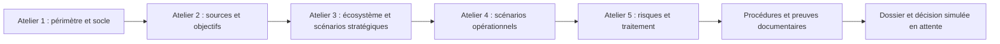

# Laboratoire GRC : risques et dossier d'homologation simulée

**Projet personnel pédagogique assisté par IA, créé le 12 novembre 2026. Données entièrement fictives.**

Ce dépôt contient un cas d'étude documenté, un registre de risques et un outil Python de contrôle de cohérence. Il relie les cinq ateliers EBIOS Risk Manager à un plan de traitement, des procédures de sécurité, une préparation d'audit et un dossier d'instruction d'homologation simulée. L'objectif est d'apprendre à rendre une analyse traçable et à justifier les décisions, pas de simplement associer des mots-clés à une matrice.

Il ne constitue ni une analyse validée par un client, ni un audit qualifié PASSI, ni une certification ISO, ni une homologation réelle, ni un outil labellisé EBIOS RM. Les documents préparés ne prouvent pas l'installation de mesures sur un système réel. Les référentiels ISO complets ne sont pas reproduits.

## Démarrage rapide

Python 3.10 ou supérieur ; uniquement la bibliothèque standard. Aucun compte cloud, paquet externe ou secret n'est nécessaire.

```text
git clone https://github.com/bibinvc/grc-risk-homologation-lab.git
cd grc-risk-homologation-lab
python app.py validate
python app.py report
python -m unittest discover -s tests -v
```

L'outil ne contacte pas le réseau, ne lance aucun scan et ne configure aucun équipement. Les commandes s'exécutent aussi depuis un autre répertoire : les chemins relatifs sont résolus depuis la racine du projet. Une entrée invalide produit des erreurs et un code de sortie non nul, sans exporter de nouveau rapport.

## Parcours de lecture

1. Commencer par les ateliers dans `docs/` : le contexte métier et les événements redoutés précèdent les scénarios de menace.
2. Examiner `data/scenario.json` : les identifiants permettent de remonter du risque jusqu'aux missions, actifs, parties prenantes et objectifs visés.
3. Lire le plan de traitement et les procédures : chaque action a un responsable fictif, une échéance et un statut.
4. Examiner la préparation d'audit, le contexte réglementaire et le dossier d'homologation : les décisions sont proposées et non signées.
5. Générer les rapports puis modifier une copie du jeu de données pour vérifier les erreurs détectées.



## Trois évaluations distinctes

- **Initiale** : appréciation de départ dans le scénario fictif.
- **Courante** : état réellement justifié dans l'exercice. Une mesure planifiée ou une procédure écrite ne permet pas de déclarer une baisse obtenue.
- **Cible** : hypothèse après mise en œuvre et vérification des actions. Ce n'est jamais un résultat acquis.

Les échelles de 1 à 4, le produit gravité × vraisemblance et les seuils des niveaux sont des choix locaux d'exercice, non une formule prescrite par ISO ou EBIOS RM. Le jeu livré conserve les risques courants au niveau initial : aucune protection technique réelle n'a été déployée. Les cibles servent à préparer une discussion de traitement.

## Ce qui est contrôlé automatiquement

La validation couvre les types, identifiants, liens entre ateliers et risques, relations réciproques des actions, dates, justifications, statuts et conditions d'acceptation simulée. Un changement annoncé de risque courant exige une mise en œuvre au laboratoire et une preuve. Les fichiers justificatifs doivent exister et rester dans le dépôt ; le rapport calcule leur taille et leur empreinte SHA-256.

Ces contrôles assurent la cohérence du dossier. Une empreinte ne prouve ni la qualité d'une preuve, ni l'efficacité d'un contrôle, ni la conformité d'un système. La pertinence des scénarios, les évaluations de risque et une décision d'homologation exigent une revue humaine compétente.

## Limites et travail restant

- Les ateliers sont un exercice individuel documenté ; aucun atelier client n'a été animé.
- Les procédures et le support de sensibilisation sont rédigés, non déployés ou dispensés.
- L'applicabilité LPM/SAIV n'est pas établie : l'organisation fictive n'a aucune désignation OIV/SIIV.
- PASSI qualifie des prestataires et prestations selon un référentiel ; il ne s'agit pas d'une qualification personnelle obtenue ici.
- L'acceptation est simulée et l'autorité fictive n'a signé aucune décision.
- Avant toute utilisation professionnelle : revoir le contexte avec les métiers, les menaces, les mesures effectivement en place, les preuves et les obligations applicables ; faire valider le dossier par les personnes habilitées.

Les références primaires et la date de consultation figurent dans `docs/references.md`. Le contrat de données est décrit dans [SPEC.md](SPEC.md). Les résultats de vérification locaux seront consignés dans `evidence/` ; la présence d'un fichier de configuration CI ne suffit pas à prouver une exécution distante.

